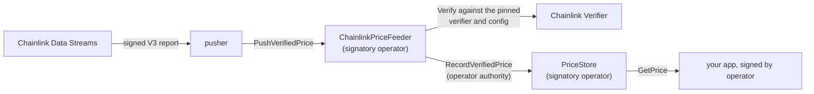

# canton-oracle-kit

[](https://github.com/PalladiumLabs/canton-oracle-kit/actions/workflows/ci.yml)
[](LICENSE)
[](https://github.com/PalladiumLabs/canton-oracle-kit/releases)
[](docs/compatibility.md)

Chainlink Data Streams prices on Canton: Daml contracts that verify a signed Chainlink report
on-ledger and store the price, plus an example pusher that keeps it fresh.

**Status:** used in production by Alpend on Canton MainNet. Audited by Halborn
([report](https://www.halborn.com/audits/alpend/smart-contract-assessment-001d47)).

> **Reads are operator-controlled.** `GetPrice` is `controller operator`, so the application that
> reads a price must be signed by the same operator party as the store. See
> [docs/limitations.md](docs/limitations.md).

## Quickstart

Requires [DPM](https://docs.digitalasset.com/build/3.4/dpm/dpm.html) with Daml SDK 3.4.11, and
Node.js 22 for the example pusher.

```bash
./scripts/fetch-dars.sh   # download Chainlink's DARs and check their SHA-256
make build                # build every Daml package
make test                 # Daml Script suite + example pusher unit tests
make demo                 # create a store and feeder, push Chainlink's signed test report, read it back
```

`make demo` runs on an in-memory ledger and needs no credentials. To run against your own ledger,
follow [docs/deployment.md](docs/deployment.md) and the [example pusher](examples/pusher/README.md).

## How a price gets written



The pusher's key can only submit genuine, currently valid Chainlink reports. It cannot write a price
directly or change which verifier is trusted. See [docs/trust-model.md](docs/trust-model.md).

## What is in the repo

| Path                       | What it is                                                                     |
| -------------------------- | ------------------------------------------------------------------------------ |
| `oracle-api`               | `VerifiedPriceSink`, the one-choice interface between a feeder and a store     |
| `oracle-chainlink`         | `ChainlinkPriceFeeder`, the V3 decoder, hex and time helpers                   |
| `oracle-price-store`       | `PriceStore`, which enforces freshness, monotonicity and a deviation hold      |
| `oracle-example-consumer`  | An example template that reads a price inside its own choice (not for deploy) |
| `oracle-tests`             | Daml Script suite and the local demo (not for deploy)                         |
| `examples/pusher`          | Example pusher (Node.js): setup, preflight, push loop                         |

## Documentation

- [Architecture](docs/architecture.md): packages, why Chainlink sits in its own package, the write path
- [Trust model](docs/trust-model.md): what the pusher key can and cannot do, and how to monitor the operator
- [Price store](docs/price-store.md): guards, the deviation hold, freshness, precision
- [Deployment](docs/deployment.md): steps, parameters and gotchas
- [Chainlink onboarding](docs/chainlink-onboarding.md): credentials, verifier contracts, feed ids
- [Operations](docs/operations.md): key and config rotation, alerts, error messages
- [Limitations](docs/limitations.md), [compatibility](docs/compatibility.md), [upgrades](docs/upgrades.md)

## Maintainers and support

Maintained by [Palladium Labs](https://github.com/PalladiumLabs) (Sats Labs Inc.) on a best-effort basis;
forks welcome. Ask questions in
[GitHub Discussions](https://github.com/PalladiumLabs/canton-oracle-kit/discussions) and report bugs
through the issue templates. Report vulnerabilities privately to hello@palladiumlabs.org; see
[SECURITY.md](SECURITY.md).

## License

[Apache-2.0](LICENSE). The Chainlink components are MIT; see
[THIRD_PARTY_NOTICES.md](THIRD_PARTY_NOTICES.md).
