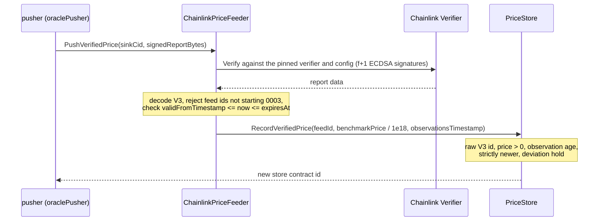

# Architecture

## Packages

| Package                    | Contents                                                                   | Depends on Chainlink DARs |
| -------------------------- | -------------------------------------------------------------------------- | ------------------------- |
| `oracle-api` 1.0.0         | `VerifiedPriceSink`, the one-choice interface between a feeder and a store | no                        |
| `oracle-chainlink` 1.0.0   | `ChainlinkPriceFeeder`, the V3 decoder, hex and time helpers               | yes                       |
| `oracle-price-store` 1.0.0 | `PriceStore`, a price store implementing `VerifiedPriceSink`               | no                        |
| `oracle-example-consumer`  | `Holding`, an example of reading a price inside another choice             | no (example only)         |
| `oracle-tests`             | Daml Script suite and the local demo                                       | yes (never deployed)      |

### What is Chainlink's and what is ours

| Component                                                                                                         | Origin                                                                                                                                                                                                    |
| ----------------------------------------------------------------------------------------------------------------- | --------------------------------------------------------------------------------------------------------------------------------------------------------------------------------------------------------- |
| `Verifier`, `VerifierConfig`, `ReportPayloadDecoder` (the `verifier`, `verifier-config`, `domain`, `common` DARs) | Chainlink, [data-streams-canton v1.0.0](https://github.com/smartcontractkit/data-streams-canton/releases/tag/v1.0.0), MIT. Not redistributed: `scripts/fetch-dars.sh` downloads them and checks their SHA-256. |
| `Palladium.Oracle.Chainlink.ReportDataV3`, `.HexToDecimal`                                                        | Adapted from Chainlink's integration examples (MIT, see [THIRD_PARTY_NOTICES.md](../THIRD_PARTY_NOTICES.md))                                                                                              |
| Everything else: feeder, verifier-pair validation, interface, price store, examples, tests                       | Palladium Labs, Apache-2.0                                                                                                                                                                                |

## Why the Chainlink code sits in its own package

Canton requires a package's full dependency closure to be vetted wherever the package is used. If
the price store referenced `Verifier` or `VerifierConfig`, every participant hosting a party that is
merely an informee on a transaction that reads a price would have to vet Chainlink's code. So the
four Chainlink DARs are confined to `oracle-chainlink`, and `oracle-price-store` depends only on
`oracle-api`. The interface has its own package so feeders and stores can be upgraded independently.

## How a price gets written

`PushVerifiedPrice` is controlled by the pusher but runs with the feeder's signatory (operator)
authority, which is what lets it reach the operator-controlled `RecordVerifiedPrice`.
